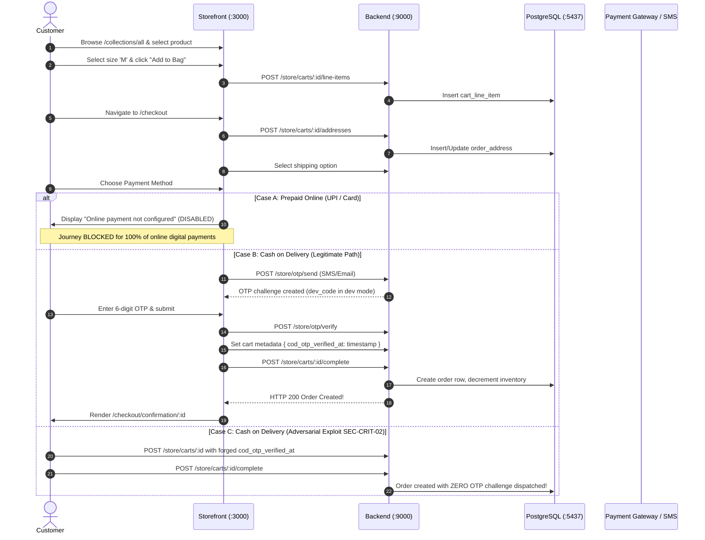
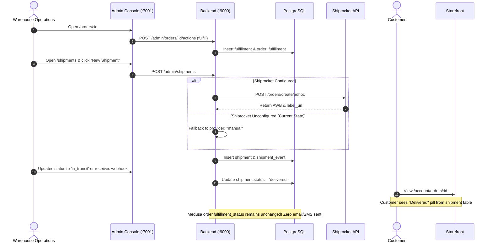

# THE HIDDEN LABEL — CROSS-FEATURE JOURNEY AUDIT
**End-to-End Evaluation of Customer, Admin, Warehouse, and Financial Workflows**

---

## 1. Executive Summary

This report maps the primary multi-step business journeys across the platform to evaluate whether discrete frontend pages, backend APIs, database mutations, and third-party services connect into coherent, completed business outcomes.

```
Overall Journey Health:
- Fully Completed End-to-End Journeys: 3
- Journeys Completed with Limitations / Fallbacks: 5
- Broken / Compromised Journeys: 2
- Disconnected / Incomplete Workflows: 2
```

---

## 2. End-to-End Journey Maps & Verification Analysis

### Journey 1: Customer Discovery -> Bag -> Checkout -> Order Placement (Prepaid vs COD)



- **Starting Action:** Customer browses catalogue on `/collections/all` or `/products/:handle`.
- **Frontend Page:** `/products/:handle` -> `/cart` -> `/checkout` -> `/checkout/payment` -> `/checkout/confirmation/:id`.
- **API Endpoints:** `GET /store/products`, `POST /store/carts/:id/line-items`, `POST /store/carts/:id/addresses`, `POST /store/otp/send`, `POST /store/otp/verify`, `POST /store/carts/:id/complete`.
- **Backend Workflow:** Medusa `addToCartWorkflow`, `completeCartWorkflow`.
- **Database Tables:** `cart`, `cart_line_item`, `order`, `order_line_item`, `order_address`, `inventory_level`, `payment_collection`.
- **External Services:** Resend (email confirmation - UNCONFIGURED); SMS Gateway (UNCONFIGURED); Razorpay (UNCONFIGURED).
- **Expected Result:** Customer receives order confirmation page and confirmation email/SMS; order persisted in database.
- **Actual Result:**
  - For Prepaid: Blocked entirely.
  - For COD: Order persists in PostgreSQL (`order` row in `pending` status), confirmation page renders cleanly; **zero emails or SMS dispatched**; vulnerable to SEC-CRIT-02 forgery.
- **Journey Status:** **B. Implemented and working with limitations (COD only)**

---

### Journey 2: Warehouse Fulfillment -> Carrier Dispatch -> Milestone Tracking



- **Starting Action:** Warehouse staff opens order in admin dashboard (`/orders/:id`).
- **Frontend Page:** `/(dashboard)/orders/:id` -> `/(dashboard)/shipments` -> Storefront `/account/orders/:id`.
- **API Endpoints:** `POST /admin/orders/:id/actions`, `POST /admin/shipments`, `PUT /admin/shipments/:id`, `GET /store/orders/:id/shipment`, `POST /webhooks/shiprocket`.
- **Database Tables:** `order`, `fulfillment`, `order_fulfillment`, `shipment`, `shipment_event`.
- **External Services:** Shiprocket REST API / Webhook receiver.
- **Expected Result:** Live carrier AWB generated; parcel tracking synchronized between courier, admin, customer order page, and customer SMS/email notifications.
- **Actual Result:**
  - Shipment record and events created and trackable at `/account/orders/:id`.
  - Shiprocket falls back to manual tracking entry.
  - Carrier events **do not update Medusa `order` table**.
  - **Zero customer notifications dispatched**.
- **Journey Status:** **B. Implemented and working with limitations**

---

### Journey 3: Customer Return Request -> RMA Approval -> Warehouse Re-Inspection -> Refund

- **Starting Action:** Customer opens delivered order on `/account/orders/:id` and clicks "Request Return".
- **Frontend Page:** `/account/orders/:id/return` -> `/account/returns` -> Admin `/(dashboard)/returns/:id`.
- **API Endpoints:** `POST /store/return-requests`, `GET /admin/returns/:id`, `POST /admin/returns/:id` (`action: "approve"`).
- **Database Tables:** `return_request`, `return_item`, `order`.
- **External Services:** Resend (Return received email - logs to console).
- **Expected Result:** Return request created; admin approves return; automated reverse courier pickup scheduled; item re-inspected; refund issued via original payment source or direct bank transfer for COD.
- **Actual Result:**
  - Return request created in `return_request` table.
  - Admin approves return, status updates to `approved`.
  - **MISSING STEPS (Failure Points):**
    1. No reverse AWB generated with Shiprocket.
    2. No reverse tracking provided to customer.
    3. No integration with condition inspection for returns.
    4. No refund execution (Razorpay refund API never called; zero bank details collection for COD returns).
    5. No return approved/rejected email dispatched to customer.
- **Journey Status:** **G. Partially implemented (Halts after administrative approval)**

---

### Journey 4: Resale Consignment -> Physical Inspection -> Tag Certification

- **Starting Action:** Consignor lists sneakers or luxury apparel on `/sell`.
- **Frontend Page:** `/sell` -> `/account/asks` -> Admin `/(dashboard)/inspections` -> Storefront `/inspection/:serial`.
- **API Endpoints:** `POST /store/resale/asks`, `GET /admin/resale/asks`, `POST /admin/inspections`, `GET /store/inspections/:unit_serial`.
- **Database Tables:** `resale_ask`, `condition_inspection`.
- **External Services:** None.
- **Expected Result:** Ask created in marketplace; unit received at warehouse; technician inspects item, assigns grade (e.g., 9.5/10), attaches physical tag `UNIT-THL-XXXXX`, logs high-res photos; public certificate accessible via QR/serial lookup.
- **Actual Result:**
  - Consignment ask created and persisted in `resale_ask`.
  - Admin creates inspection record in `condition_inspection`.
  - Unit serial certificate renders cleanly with photo gallery and inspector ID at `/inspection/[serial]` and `/verify/[serial]`.
- **Journey Status:** **A. Fully implemented and verified working**

---

### Journey 5: Fit Studio Profile -> Automated Silhouette Sizing Guidance

- **Starting Action:** Customer inputs measurements on `/fit-studio` or product page size modal.
- **Frontend Page:** `/fit-studio` -> `/products/:handle`.
- **API Endpoints:** `POST /store/fit/profile`, `POST /store/fit/recommend`, `GET /admin/fit-rules`.
- **Database Tables:** `customer_fit_profile`, `silhouette_fit_rule`.
- **External Services:** None.
- **Expected Result:** Customer measurements saved; product page queries fit rules for brand and category, outputting recommended size and silhouette ease notes.
- **Actual Result:**
  - Profile persists to `customer_fit_profile`.
  - Rule engine evaluates chest/waist bounds against `silhouette_fit_rule` and returns accurate size recommendations (e.g. `M - Relaxed fit across shoulders`).
- **Journey Status:** **A. Fully implemented and verified working**

---

### Journey 6: Administrative RBAC Governance & Staff Management

- **Starting Action:** Owner manages staff roles in `/settings`.
- **Frontend Page:** `/(dashboard)/settings` -> `/(dashboard)/audit`.
- **API Endpoints:** `GET /admin/users`, `POST /admin/invites`, `POST /admin/users/me` (Medusa Core).
- **Database Tables:** `user`, `invite`.
- **Expected Result:** Strict permission barrier where only Owner can assign or escalate roles; readonly users blocked from write mutations and sensitive PII.
- **Actual Result:**
  - Multi-role permission check passes across core admin endpoints (`readonly` blocked with 403 on orders/users; `support` read-only).
  - **CRITICAL FAILURE POINT (SEC-CRIT-01):** Any staff member with `readonly` credentials can issue `POST /admin/users/me` with `{"metadata": {"role": "owner"}}`. The backend immediately mutates `user.metadata.role` to `owner`, bypassing all RBAC barriers.
- **Journey Status:** **C. Implemented but broken / Critically Vulnerable**

---

## 3. Disconnected & Orphaned Technical Assets Register

| Asset Name | Exact File Location | Intended Purpose | Current Orphaned Status |
|---|---|---|---|
| `orderEmailHtml` | `apps/backend/src/lib/email.ts#L54-L79` | Branded HTML order confirmation email | **Completely Orphaned:** Defined in `email.ts` but never imported or invoked anywhere in the codebase. |
| `POST /admin/audit` | `apps/backend/src/api/admin/audit/route.ts` | Administrative audit log viewer | Reads staff login and order logs; disconnected from real-time security alerts. |
| `ConditionInspection` on Returns | `apps/backend/src/modules/thl/models/condition-inspection.ts` | Re-inspect returned garments | **Disconnected:** Return approval in `admin/returns/[id]` does not create or link to an inspection record. |
| Razorpay Webhook Verifier | `apps/backend/src/modules/razorpay/service.ts#L220` | Inbound payment webhook HMAC verification | **Disconnected:** No `/webhooks/razorpay` API route exists in `apps/backend/src/api/webhooks/` to receive events. |
| `refundPayment` API Client | `apps/backend/src/modules/razorpay/service.ts#L201` | Automated refund through gateway | **Orphaned:** Never called by customer return workflows or admin return approval handlers. |
