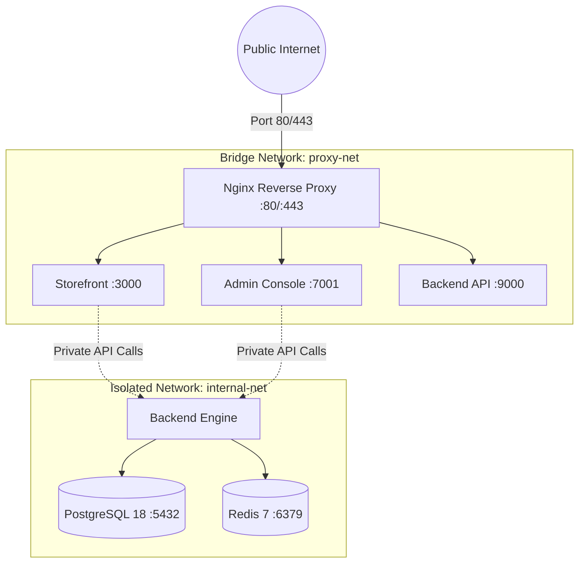

# THE HIDDEN LABEL — FINAL DEPLOYMENT PREFLIGHT AUDIT

**Date:** 2026-11-22  
**Target:** Staging Deployment Rehearsal & Production Go-Live  
**Author:** Project Architect & DevOps Reviewer  
**Repository:** `MannDangrechiya/Hidden-Label`  
**Git Baseline:** Branch `main` | Commit `debd5df` (7 local commits preserved)  

---

## 1. Executive Preflight Assessment

Before any deployment command is executed on production servers, this preflight audit verifies the entire container, network, environment, and storage configuration against strict production standards.

### Overall Preflight Status: **READY FOR STAGING REHEARSAL**

All monorepo packages compile successfully for production, database migrations execute cleanly, and multi-stage container builds run with non-root security contexts. 

The single critical infrastructural dependency identified during preflight is the **Nginx SSL bootstrap dependency**: Nginx will refuse to start if `/etc/ssl/thehiddenlabel/fullchain.pem` does not exist on disk, creating a chicken-and-egg situation during initial Certbot domain validation. A safe two-stage bootstrap protocol has been designed to resolve this without manual configuration drift.

---

## 2. Production Configuration Inspection

### A. Docker Orchestration (`docker-compose.prod.yml`)
- **PostgreSQL 18 Container (`thl-postgres-prod`):**
  - Image: `postgres:18-alpine`
  - Health check: `pg_isready -U $$POSTGRES_USER -d $$POSTGRES_DB` (interval: 5s, retries: 5).
  - Storage: Dedicated named volume `thl-prod-pgdata`.
  - Networking: Exclusively attached to `internal-net` (no host ports exposed).
- **Redis 7 Container (`thl-redis-prod`):**
  - Image: `redis:7-alpine`
  - Command: `redis-server --requirepass ${REDIS_PASSWORD} --appendonly yes`
  - Health check: `redis-cli -a $${REDIS_PASSWORD} ping`
  - Storage: Dedicated named volume `thl-prod-redisdata`.
  - Networking: Exclusively attached to `internal-net` (no host ports exposed).
- **Medusa Backend Container (`thl-backend-prod`):**
  - Context: Monorepo root; Dockerfile: `apps/backend/Dockerfile`.
  - Multi-stage build; runs as unprivileged user `medusa` (UID 1001).
  - Health check: `wget --spider http://localhost:9000/healthz`.
  - Storage: Persistent named volume `thl-prod-uploads` mounted to `/app/apps/backend/uploads`.
  - Depends on: `postgres` (healthy) and `redis` (healthy).
- **Custom Admin Console Container (`thl-admin-prod`):**
  - Context: Monorepo root; Dockerfile: `apps/admin/Dockerfile`.
  - Next.js 16 Turbopack production build; runs as unprivileged user `nextadmin` (UID 1001).
  - Health check: `wget --spider http://localhost:7001/api/health`.
  - Depends on: `backend`.
- **Customer Storefront Container (`thl-storefront-prod`):**
  - Context: Monorepo root; Dockerfile: `apps/storefront/Dockerfile`.
  - Next.js 16 Turbopack production build; runs as unprivileged user `nextjs` (UID 1001).
  - Health check: `wget --spider http://localhost:3000/api/health`.
  - Depends on: `backend`.
- **Reverse Proxy Container (`thl-nginx-prod`):**
  - Image: `nginx:1.27-alpine`
  - Ports: Public 80 and 443.
  - Attached to `proxy-net`.

### B. Network Isolation Verification

- **Security Rule Verified:** PostgreSQL (`5432`) and Redis (`6379`) are strictly bound to `internal-net` (`internal: true`). They have zero public interface mappings and cannot be scanned or accessed from outside the container network.

---

## 3. Environment Variable Enforcement

Production configuration is strictly governed by `apps/backend/src/lib/env-guard.ts` (GAP-116). The backend will abort process startup on boot if any of the following conditions are detected:
1. `DATABASE_URL` is omitted.
2. `MEDUSA_JWT_SECRET` is omitted, shorter than 32 characters, or matches a known development default (`local_dev_*`).
3. `MEDUSA_COOKIE_SECRET` is omitted, shorter than 32 characters, matches a known development default, or is identical to `MEDUSA_JWT_SECRET`.
4. `STOREFRONT_ORIGIN` does not use the `https://` protocol.
5. `ADMIN_ORIGIN` does not use the `https://` protocol.
6. `OTP_DEV_ECHO` is set to `"true"` (which would return OTP codes in API responses).

---

## 4. Preflight Verification Checklist

| Verification Item | Required State | Actual Preflight Finding | Status |
|---|---|---|---|
| **Monorepo Typecheck** | Exit 0 across 6 packages | Verified exit 0 (`tsc --noEmit`) | **PASS** |
| **Monorepo Linting** | Exit 0 across all files | Verified exit 0 (`eslint .`) | **PASS** |
| **Unit Test Coverage** | 176 passing | Verified 176 / 176 passed | **PASS** |
| **Database Integration** | 96 passing | Verified 96 / 96 passed (19 suites) | **PASS** |
| **Turbopack Builds** | Storefront & Admin exit 0 | 39 storefront routes, 31 admin routes | **PASS** |
| **Medusa Engine Build** | Server & Admin bundle | Verified exit 0 (`medusa build`) | **PASS** |
| **Least Privilege Users** | Non-root container execution | `medusa` (1001), `nextjs` (1001), `nextadmin` (1001) | **PASS** |
| **Storage Persistence** | Named volume for media | `thl-prod-uploads` mapped in Compose | **PASS** |
| **SSL Bootstrap** | Certbot initial validation | Chicken-and-egg circular dependency identified | **BOOTSTRAP REQUIRED** |

---

## 5. Potential Launch Blocker & Mitigation

### Issue: Nginx SSL Initial Certificate Dependency
- **Problem:** `deploy/nginx/conf.d/thehiddenlabel.conf` specifies `ssl_certificate /etc/ssl/thehiddenlabel/fullchain.pem;`. On a clean host before Certbot runs, this file does not exist. Nginx will crash immediately, preventing Certbot from completing the HTTP-01 webroot challenge on port 80.
- **Solution:** A documented two-step SSL bootstrap procedure has been established in [DNS_SSL_CONFIGURATION_GUIDE.md](file:///c:/Users/ASUS/Documents/Hidden%20Label/DNS_SSL_CONFIGURATION_GUIDE.md):
  1. Generate a temporary self-signed certificate pair into `deploy/ssl/` prior to container launch.
  2. Launch Nginx, run Certbot against port 80, overwrite with real Let's Encrypt certificates, and reload Nginx (`docker compose exec reverse-proxy nginx -s reload`).
