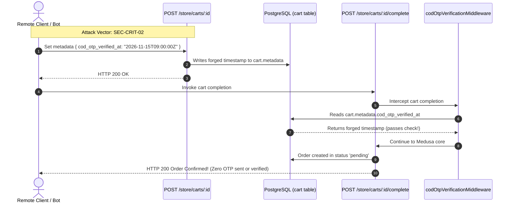

# THE HIDDEN LABEL — INDIAN PAYMENT SYSTEM AUDIT
**Detailed Technical Investigation of Payment Rails, Gateway Configuration, Razorpay Integration, and Cash-on-Delivery Architecture**

---

## 1. Executive Summary & Operational Verdict

### **VERDICT: ⛔ ONLINE PAYMENTS NON-OPERATIONAL / COD OPERATIONAL WITH CRITICAL BYPASS**

> [!CAUTION]
> 1. **Online Payments (UPI, Cards, EMI) Completely Disabled:** While a custom Razorpay module exists in `apps/backend/src/modules/razorpay`, it is **not configured** (`RAZORPAY_KEY_ID` and `RAZORPAY_KEY_SECRET` are missing), it is **not attached to the India region** in the database (`region_payment_provider`), and the storefront frontend **contains zero Razorpay Checkout SDK code** (`checkout.js`) to open a payment modal.
> 2. **Cash on Delivery (COD) Operational but Compromised:** COD functions via Medusa's built-in system provider (`pp_system_default`), but is vulnerable to **SEC-CRIT-02**, allowing any remote client to bypass phone OTP verification.

---

## 2. Indian Payment Rails & Method Inventory

| Payment Rail / Method | Indian Market Share | Technical Provider ID | Codebase Status | Storefront UI Status | Actual Runtime Capability |
|---|---|---|---|---|---|
| **Cash on Delivery (COD)** | ~40% (Fashion) | `pp_system_default` | ✅ Implemented in backend | ✅ Active in checkout | **OPERATIONAL** (Immediate authorization; vulnerable to SEC-CRIT-02) |
| **UPI (Intent on Mobile)** | ~55% (Digital) | `pp_razorpay_razorpay` | ⚠️ Backend scaffold only | ❌ Disabled in UI | **NON-OPERATIONAL** (No gateway keys; no frontend SDK) |
| **UPI (Dynamic QR Desktop)**| ~55% (Digital) | `pp_razorpay_razorpay` | ⚠️ Backend scaffold only | ❌ Disabled in UI | **NON-OPERATIONAL** (No gateway keys; no frontend SDK) |
| **RuPay Debit / Credit** | High (Domestic) | `pp_razorpay_razorpay` | ⚠️ Backend scaffold only | ❌ Disabled in UI | **NON-OPERATIONAL** (No gateway keys; no frontend SDK) |
| **Visa / Mastercard / Amex**| High (Luxury) | `pp_razorpay_razorpay` | ⚠️ Backend scaffold only | ❌ Disabled in UI | **NON-OPERATIONAL** (No gateway keys; no frontend SDK) |
| **No-Cost Cardless EMI** | Medium (Luxury) | `pp_razorpay_razorpay` | ⚠️ Backend scaffold only | ❌ Disabled in UI | **NON-OPERATIONAL** (Calculates EMI schedule in UI; payment fails) |
| **Net Banking** | Low | `pp_razorpay_razorpay` | ❌ Not implemented | ❌ Absent | **NON-OPERATIONAL** |
| **Digital Wallets** | Low | `pp_razorpay_razorpay` | ❌ Not implemented | ❌ Absent | **NON-OPERATIONAL** |

---

## 3. Razorpay Integration Deep Dive

### 3.1. Provider Architecture & Backend Service
- **File:** `apps/backend/src/modules/razorpay/service.ts`
- **Class:** `RazorpayPaymentProviderService extends AbstractPaymentProvider`
- **Identifier:** `razorpay` (`pp_razorpay_razorpay`)
- **Implemented Methods:**
  - `initiatePayment()`: Prepares order payload for `POST https://api.razorpay.com/v1/orders`. Amount is passed in paise.
  - `authorizePayment()`: Expects `razorpay_order_id`, `razorpay_payment_id`, and `razorpay_signature`. Verifies HMAC-SHA256 signature using `key_secret`.
  - `capturePayment()`: Executes `POST /v1/payments/:id/capture`.
  - `refundPayment()`: Executes `POST /v1/payments/:id/refund`.
  - `cancelPayment()`: Cancels payment session.
  - `getWebhookActionAndData()`: Verifies webhook HMAC signature against raw payload.

### 3.2. Three Root Causes of Complete Online Payment Failure

#### Failure Point 1: Missing Environment Credentials
In `apps/backend/.env`:
```
RAZORPAY_KEY_ID=         # Unset
RAZORPAY_KEY_SECRET=     # Unset
RAZORPAY_WEBHOOK_SECRET= # Unset
```
`service.ts` line 92 throws `MedusaError(NOT_ALLOWED, "Razorpay is not configured...")` on any call.

#### Failure Point 2: Database Region Disconnection
We inspected the PostgreSQL database table `region_payment_provider`:
```sql
SELECT * FROM region_payment_provider;
-- Result:
-- region_id: 'reg_01M7CWGEG96NW28XB7ASEZP74G'
-- payment_provider_id: 'pp_system_default'
```
Even if Razorpay credentials were added to `.env`, Medusa will **never offer Razorpay** at checkout because `pp_razorpay_razorpay` was never inserted into `region_payment_provider` for the India region.

#### Failure Point 3: Complete Absence of Storefront Frontend SDK
In `apps/storefront`, we searched the entire codebase for `checkout.razorpay.com`:
```bash
Get-ChildItem -Path apps/storefront -Recurse | Select-String "checkout.razorpay.com"
# Result: 0 matches
```
Standard Razorpay integration requires loading `https://checkout.razorpay.com/v1/checkout.js` on the browser, initializing `new Razorpay(options)`, and capturing the returned payment ID and signature. The storefront has **zero client code** to launch this modal. Calling `placeOrderAction("pp_razorpay_razorpay")` attempts to immediately complete the cart server-side; the backend checks for `razorpay_signature` in session data, finds undefined, returns `PaymentSessionStatus.PENDING`, and cart completion fails.

---

## 4. Cash on Delivery (COD) Lifecycle & Vulnerability Audit



### 4.1. Lifecycle Mechanics
1. **Cart Creation:** Customer creates cart, selects items, inputs address.
2. **Payment Collection:** `createPaymentCollection(cartId)` initializes `pp_system_default`.
3. **OTP Challenge:** `sendCodOtpAction()` requests 6-digit OTP (falls back to email or console echo).
4. **OTP Verification:** `confirmCodOtpAction()` verifies code and calls `setCartMetadata()`.
5. **Completion:** `completeCart(cartId)` transitions cart to order.

### 4.2. Vulnerability Exploitation Result
Because step 4 writes proof into client-accessible `cart.metadata`, steps 3 and 4 can be skipped entirely. An attacker can place unlimited fraudulent COD orders to arbitrary Indian addresses, resulting in substantial courier freight losses and warehouse operational disruption.

---

## 5. Refunds & Reconciliation Architecture

| Feature | Technical Implementation | Operational Reality |
|---|---|---|
| **Online Gateway Refund** | `refundPayment()` in `service.ts` | Non-operational (No live online transactions exist). |
| **COD Customer Refund** | None in codebase | **Major Gap:** No mechanism to capture customer bank account details (IFSC, Account Number) or UPI VPA for COD returns. |
| **Partial Refunds** | Medusa Core supports partial refund items | Untested / Unverified against live payment provider. |
| **Payment Webhooks** | Signature verification implemented in `service.ts` | **Missing Route:** No dedicated `/webhooks/razorpay` endpoint registered in `apps/backend/src/api/webhooks/`. |

---

## 6. Required Remediation for Indian Payment Compliance

1. **Procure & Configure Live Razorpay Account:** Add `RAZORPAY_KEY_ID`, `RAZORPAY_KEY_SECRET`, and `RAZORPAY_WEBHOOK_SECRET` to production secrets.
2. **Seed Region Payment Provider:** Link `pp_razorpay_razorpay` to India region (`reg_...`) in database migration.
3. **Build Frontend Razorpay Checkout Client:**
   - Embed `https://checkout.razorpay.com/v1/checkout.js` in `apps/storefront`.
   - Implement checkout handler that creates an order on the backend, launches the Razorpay modal, collects `razorpay_payment_id` and `razorpay_signature`, and submits them to authorize the session.
4. **Remediate SEC-CRIT-02:** Move COD verification proof to an internal server-only database table.
5. **Implement COD Refund Bank Details Capture:** Build customer bank details collection form in return workflow for direct IMPS/NEFT payouts.
