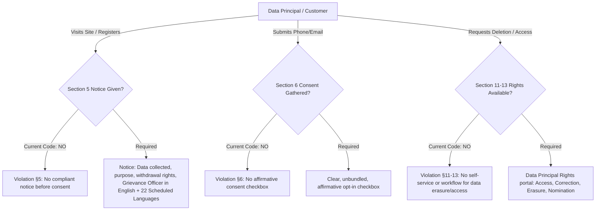

# THE HIDDEN LABEL — INDIA PRIVACY, CONSENT & E-COMMERCE COMPLIANCE AUDIT
**Statutory Review against DPDP Act 2023 / Rules 2025, Consumer Protection (E-Commerce) Rules 2020, and Legal Metrology Regulations**

---

## 1. Executive Summary & Regulatory Disclaimer

### **VERDICT: ⛔ CRITICAL STATUTORY DEFICIENCIES — REQUIRES IMMEDIATE LEGAL REMEDIATION**

> [!CAUTION]
> **Legal Disclaimer:** This report constitutes a technical architectural audit of codebase assets, policies, consent mechanisms, and UI disclosures. It does **not** constitute a formal legal opinion or compliance certificate. All findings, regulatory gaps, and drafting recommendations must be reviewed by qualified Indian legal counsel specializing in cyber law, privacy, and retail taxation prior to commercial launch.

The platform in its current form exhibits **severe non-compliance across three core Indian legislative frameworks**:
1. **Digital Personal Data Protection Act, 2023 (DPDP Act) & DPDP Rules, 2025:** Absence of compliant Section 5 notice, missing multi-language support (Eighth Schedule), zero consent checkboxes at registration/checkout, absence of Data Principal rights workflows (erasure, access, nomination), and no designated Data Protection / Grievance contact.
2. **Consumer Protection (E-Commerce) Rules, 2020:** Absence of statutory corporate disclosures (Corporate Identity Number - CIN, full registered address, direct customer care phone, published Grievance Officer details with 48h/30d SLAs).
3. **Legal Metrology (Packaged Commodities) Amendment Rules:** Absence of mandatory product disclosures on product detail pages (Country of Origin, Manufacturer/Packer/Importer identity, Maximum Retail Price - MRP inclusive of all taxes, dimensions, and net quantity).

---

## 2. Digital Personal Data Protection Act, 2023 (DPDP Act) & DPDP Rules, 2025 Audit

### 2.1. Section 5 Notice Requirements
- **Statutory Mandate:** Before or at the time of seeking consent, the Data Fiduciary (The Hidden Label) must provide an itemized notice stating:
  1. The specific personal data to be collected and purpose of processing.
  2. The manner in which the customer may exercise rights under the Act.
  3. Contact details of the Data Protection Officer (DPO) or designated grievance contact.
  4. The right to make a complaint to the Data Protection Board of India.
  5. The notice must be accessible in English and any of the **22 languages specified in the Eighth Schedule to the Constitution of India**.
- **Current Code Status:** **FAILED / NON-COMPLIANT**.
  - The privacy policy (`slug: "policies/privacy"`) is a brief 3-paragraph placeholder.
  - It does not enumerate personal data categories (e.g. phone, address, fit measurements, device IP).
  - It does not disclose third-party processors (Resend, Shiprocket, Razorpay, Google Gemini).
  - It is available exclusively in English.
  - It contains zero references to the DPDP Act or the Data Protection Board of India.

### 2.2. Section 6 Consent Framework
- **Statutory Mandate:** Consent must be *free, specific, informed, unconditional, and unambiguous with a clear affirmative action*. Pre-ticked boxes or bundled terms are explicitly prohibited.
- **Current Code Status:** **FAILED / NON-COMPLIANT**.
  - Customer registration (`app/register/page.tsx`) contains **zero consent checkboxes**.
  - Clicking "Create account" submits credentials without an affirmative confirmation that the user has reviewed and consented to the Privacy Policy.
  - Checkout (`app/checkout/page.tsx`) captures phone, delivery address, and payment choice without any affirmative data processing consent checkbox.

### 2.3. Sections 11, 12, 13: Data Principal Rights
- **Right to Access Information (§11):** No automated or self-service mechanism for a customer to download a copy of all personal data, fit measurements, order history, and tracking logs stored about them.
- **Right to Correction & Erasure (§12):**
  - Correction: Customers can update name and phone at `/account`.
  - Erasure (Account Deletion): **Zero implementation**. There is no "Delete Account" button or API endpoint anywhere in `@thl/storefront` or `@thl/backend`. Customers cannot delete their account or revoke processing consent.
- **Right of Grievance Redressal (§13):** No redressal workflow exists within the platform.
- **Right to Nominate (§14):** No mechanism exists for a customer to designate a nominee in the event of death or incapacity.

---

## 3. Consumer Protection (E-Commerce) Rules, 2020 Audit

| Regulatory Provision | Statutory Disclosure Requirement | Current Platform State | Compliance Evaluation |
|---|---|---|---|
| **Rule 4(1): Entity Identity** | Legal business name, principal geographic address, website URL | Displayed on invoice; missing in website footer | ⚠️ **PARTIAL** |
| **Rule 4(2): Corporate Details**| Corporate Identity Number (CIN) or registration number | Absent on all pages and policies | ❌ **NON-COMPLIANT** |
| **Rule 4(3): Direct Contacts** | Official contact email, customer support phone number | `orders@thehiddenlabel.com` mentioned; phone absent | ❌ **NON-COMPLIANT** |
| **Rule 4(4): Grievance Officer**| Name, designation, direct phone, and email of Grievance Officer | Completely absent across all pages | ❌ **NON-COMPLIANT** |
| **Rule 4(5): Redressal SLA** | Explicit commitment to acknowledge complaints in 48h, resolve in 30d | Absent across all pages | ❌ **NON-COMPLIANT** |
| **Rule 5(3): Price Breakdown** | Itemized display of price, postage/shipping, applicable taxes | Displayed in cart and checkout | ✅ **COMPLIANT** |
| **Rule 6: Country of Origin** | Prominent country of origin on every product card/PDP | Stored on `brand.country`; **omitted from PDP** | ❌ **NON-COMPLIANT** |
| **Rule 6: Importer / Packer** | Complete identity of manufacturer/importer on PDP | Absent on product detail pages | ❌ **NON-COMPLIANT** |
| **Rule 6: Return Terms** | Transparent return, refund, and exchange terms prior to checkout | Published in `policies/returns`; rendered at checkout | ✅ **COMPLIANT** |

---

## 4. Legal Metrology (Packaged Commodities) Amendment Rules Audit

Under Rule 6 of the Legal Metrology (Packaged Commodities) Rules, 2011 (as amended for e-commerce entities), every digital commerce platform offering pre-packaged goods in India must prominently display mandatory statutory declarations on the digital product display page (PDP):

1. **Name and Address of the Manufacturer / Packer / Importer:**
   - *Status:* **MISSING**. `apps/storefront/app/products/[handle]/page.tsx` renders product title, price, brand handle, and description. It omits the legal corporate identity of the importer or manufacturer.
2. **Country of Origin:**
   - *Status:* **MISSING**. While the database table `brand` contains a `country` column, this attribute is **not rendered on the Product Detail Page**, violating Department of Consumer Affairs enforcement directives.
3. **Maximum Retail Price (MRP):**
   - *Status:* **MISSING**. The PDP displays a single selling price in INR (e.g., `₹24,000`). Indian Legal Metrology mandates declaring:
     `MRP: ₹XX,XXX (Inclusive of all taxes)`.
   - Selling products online without declaring the original MRP and the tax-inclusive nature of the price is a punishable offense under Section 36 of the Legal Metrology Act, 2009.
4. **Net Quantity & Garment Dimensions:**
   - *Status:* **MISSING**. Standard apparel declarations require declaring: `Net Quantity: 1 Unit / 1 N`, along with standardized chest/waist sizing in centimeters.

---

## 5. Marketing, SMS & Cookie Consent Architecture

### 5.1. Cookie & Tracking Consent
- **Current State:** **ZERO CONSENT BANNER**.
- The storefront utilizes cookies for:
  - Customer authentication token (`thl_auth_token`)
  - Active cart identification (`thl_cart_id`)
  - Admin authentication token (`thl_admin_token`)
- While these are strictly necessary first-party session cookies, standard Indian privacy practices require a transparent cookie declaration and opt-in consent before deploying any future tracking pixels (Meta Pixel, Google Analytics, Hotjar).

### 5.2. Commercial SMS & TRAI Consent
- Under TRAI TCCCPR 2018 regulations, commercial messaging (promotional drop notifications, private sale alerts) requires explicit registered consent.
- The registration form lacks a separate, unbundled opt-in checkbox for promotional messaging. Sending marketing SMS without verifiable consent exposes the business to TRAI penalty blacklisting.

---

## 6. Required Remediation for Statutory Legal Compliance

1. **Draft Comprehensive Legal Documentation with Counsel:**
   - Retain qualified Indian corporate legal counsel to replace generic placeholder policies with legally vetted documents:
     - `TERMS_OF_SERVICE.md` (Including CIN, registered office, jurisdiction in Ahmedabad courts, dispute arbitration).
     - `PRIVACY_POLICY.md` (DPDP Act 2023 compliant, data retention schedules, third-party processor declarations, DPO contact).
     - `SHIPPING_AND_DELIVERY_POLICY.md` (Clear courier SLAs, non-serviceable pin codes, RTO conditions).
     - `RETURN_EXCHANGE_REFUND_POLICY.md` (7-day window, non-returnable categories for bespoke tailoring, COD refund terms).
2. **Implement Statutory Website Footer & Grievance Notice:**
   - Add persistent footer displaying:
     - Company Legal Name: *The Hidden Label Luxury Retail Private Limited*
     - CIN: `Uxxxxxxxxxxxxxxx`
     - Registered Office: Sindhu Bhavan Road, Bodakdev, Ahmedabad, Gujarat 380054
     - Grievance Officer: Name, Email (`grievance@thehiddenlabel.com`), Telephone
     - National Consumer Helpline convergence acknowledgment
3. **Update Product Detail Page (Legal Metrology Compliance):**
   - Render statutory disclosure box on PDP:
     - Country of Origin: e.g., `France` / `United Kingdom` / `India`
     - Manufacturer / Importer: e.g., `Imported & Marketed by The Hidden Label Luxury Retail Pvt Ltd...`
     - Maximum Retail Price: `MRP: ₹XX,XXX (incl. of all taxes)`
     - Net Quantity: `1 Piece (1 N)`
4. **Implement Affirmative Privacy & Marketing Checkboxes:**
   - Add mandatory, un-ticked consent checkbox to `/register`:
     - `[ ] I have read and agree to the Terms of Service and Privacy Policy.`
   - Add optional, unbundled marketing checkbox:
     - `[ ] Send me exclusive drop invitations and private collection alerts via WhatsApp and SMS.`
5. **Build Account Deletion & Data Export Workflows:**
   - Add "Request Account Deletion" button in `/account` triggering customer data anonymization in compliance with DPDP Act Section 12.
