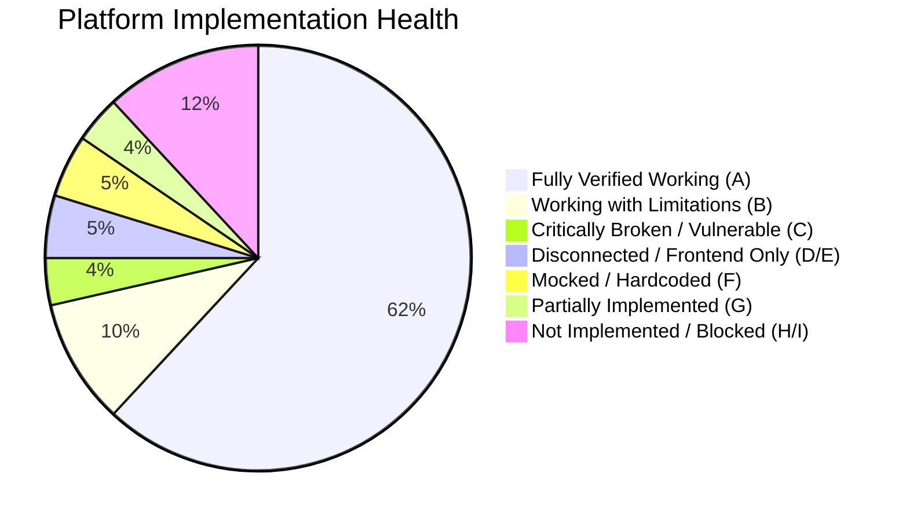

# THE HIDDEN LABEL — MASTER AUDIT SUMMARY & PRODUCTION READINESS REPORT
**Master Executive Synthesis of Codebase Discovery, Indian E-Commerce Readiness, and Architectural Audit**

---

## 1. Executive Summary & Master Verdict

### **OVERALL PLATFORM VERDICT: ⛔ NOT READY FOR PRODUCTION (RELEASE BLOCKED)**

> [!CAUTION]
> **COMPREHENSIVE AUDIT VERDICT: RELEASE BLOCKED**  
> While **THE HIDDEN LABEL** possesses a well-structured modern foundation—featuring Medusa 2.22.7 core commerce on PostgreSQL 18.6, Next.js 16.4.6 App Router storefront and admin consoles, custom condition inspection tagging, silhouette fit rules, and consignment data models—**the platform CANNOT be deployed for commercial Indian luxury e-commerce operations in its current state**.
> 
> The audit discovered **35 specific functional gaps**, including **two critical security vulnerabilities**, **complete absence of database tax configuration**, **statutorily non-compliant GST invoicing**, **unimplemented Indian SMS infrastructure**, **a disconnected digital payment gateway**, **unconfigured courier credentials**, and **total absence of customer transactional notifications**.

---

## 2. Multi-Pillar Scorecard



| Audit Pillar | Evaluation | Score | Core Blocker / Finding Summary |
|---|---|---|---|
| **1. Access Control & Security** | ❌ **FAIL** | 4 / 10 | **SEC-CRIT-01:** Universal privilege escalation to `owner` via `/admin/users/me`.<br>**SEC-CRIT-02:** Client forgery of COD phone OTP verification via public cart API. |
| **2. Core Commerce & Catalog** | ✅ **PASS** | 9 / 10 | 12 core CRUD workflows execute cleanly in PostgreSQL; stock reservation, variant selection, and cart operations functional. |
| **3. GST Invoicing & Taxation** | ⛔ **BLOCKED** | 1 / 10 | Zero tax configuration in DB (0 rows); hardcoded CGST/SGST nationwide (illegal on inter-state shipments); dummy GSTIN; universal HSN 6403. |
| **4. Payment Gateway (Razorpay)** | ⛔ **BLOCKED** | 2 / 10 | Keys unset; provider not attached to India region; storefront contains zero Razorpay SDK code (`checkout.js`); 100% of online payments disabled. |
| **5. Phone Validation & OTP** | ⛔ **BLOCKED** | 3 / 10 | Zero SMS gateway integration in code; returns 501 or leaks code via dev echo; rejects bare 10-digit Indian numbers without `+91`. |
| **6. Shipping & Logistics (Shiprocket)**| ⚠️ **FALLBACK** | 4 / 10 | Credentials unset; falls back to manual dispatch; hardcoded package dimensions (30×20×12 cm, 0.6 kg); hardcoded "COD" payment method. |
| **7. Transactional Email (Resend)** | ⛔ **BLOCKED** | 2 / 10 | API key unset; logs to console; zero order, shipment, or delivery confirmation emails exist in codebase; `orderEmailHtml` is orphaned dead code. |
| **8. Indian Address Intelligence** | ⚠️ **BASIC** | 4 / 10 | 6-digit regex only; no auto-completion of City/State; accepts PIN/State mismatches; zero courier delivery or COD serviceability check. |
| **9. Customer Support & Grievance** | ❌ **FAIL** | 2 / 10 | Static FAQ CMS page only; no contact form; no ticketing system; no Grievance Officer details (violates Consumer Protection Rules, 2020). |
| **10. Privacy & Legal Compliance** | ❌ **FAIL** | 2 / 10 | Non-compliant with DPDP Act 2023 / Rules 2025; no affirmative consent checkboxes; no account deletion workflow; missing Legal Metrology on PDP. |
| **11. Luxury Bespoke & Resale** | ✅ **PASS** | 8.5 / 10 | Physical unit inspection (`UNIT-THL-XXXXX`), condition certificates, fit rules engine, and consignment orderbook data models verified working. |
| **12. Production Infrastructure** | ⚠️ **LOCAL** | 4 / 10 | Local embedded PostgreSQL on port 5437; in-memory Redis fallback; missing HSTS and CSP headers; CORS bound to localhost. |

---

## 3. Top Critical Release Blockers (Stop-Ship Defects)

### Blocker 1: Universal Privilege Escalation (SEC-CRIT-01)
- **Impact:** Any authenticated staff user with a restricted role (`readonly`, `support`, `operations`) can issue `POST /admin/users/me` with `{"metadata": {"role": "owner"}}`. Medusa immediately elevates the actor to full `owner` privileges, bypassing all RBAC barriers and exposing sensitive financial data and customer PII.
- **Location:** `apps/backend/src/api/middlewares.ts` lines 144–151.

### Blocker 2: Client-Side Forgery of Cash-on-Delivery OTP (SEC-CRIT-02)
- **Impact:** Any remote client or malicious bot can bypass the phone OTP challenge entirely by sending `{"metadata": {"cod_otp_verified_at": timestamp}}` to `POST /store/carts/:id` and completing the cart. This permits fraudulent mass order placement without solving an SMS challenge.
- **Location:** `apps/backend/src/api/middlewares.ts` lines 76–86.

### Blocker 3: Zero Database Tax Engine & Non-Compliant GST Invoicing
- **Impact:** Medusa computes `tax_total = 0` on all orders. The printable invoice template uses a fake GSTIN (`24AAACT1234F1Z5`), charges Gujarat CGST+SGST on orders shipped nationwide to other states (violating the IGST Act, 2017), and misclassifies all luxury apparel as Footwear (HSN 6403).
- **Location:** Database tables `tax_region`, `tax_rate`; Storefront `app/account/orders/[id]/invoice/page.tsx`.

### Blocker 4: Total Failure of Digital Online Payments (Razorpay)
- **Impact:** 100% of Indian online payment methods (UPI, RuPay, Visa, Mastercard, Net Banking, EMI) are disabled. The backend lacks API keys, the region lacks the provider link, and the storefront lacks the Razorpay Checkout JavaScript SDK.
- **Location:** `apps/backend/.env`, table `region_payment_provider`, `apps/storefront/components/checkout-payment-form.tsx`.

### Blocker 5: Zero SMS Gateway Code & Unconfigured Email
- **Impact:** The backend has no code integrating with an SMS gateway; real SMS dispatch is impossible. Resend credentials are missing, and no email event subscribers exist for order placement, shipment, or delivery. Customers receive zero automated notifications after placing an order.
- **Location:** `apps/backend/src/api/store/otp/send/route.ts`, `apps/backend/src/lib/email.ts`.

### Blocker 6: Statutory Indian Legal & Privacy Violations
- **Impact:** Operating without a published Grievance Officer, without DPDP Act Section 5 notices, and without Legal Metrology declarations on product pages exposes the business to regulatory sanctions under the Consumer Protection Act, 2019 and Legal Metrology Act, 2009.
- **Location:** Storefront legal policies, `/support` page, `/products/[handle]/page.tsx`.

---

## 4. Master Register of the 18 Audit Deliverables

All 18 comprehensive audit reports have been compiled and delivered directly to the project root:

1. `MASTER_BUSINESS_ARCHITECTURE.md` — Complete 18-stage operating model, bespoke tailoring, consignment, and domain architecture.
2. `COMPLETE_FEATURE_INVENTORY.md` — Technical asset register of all 3 applications, 3 packages, 168 database tables, and routes.
3. `STOREFRONT_PAGE_BY_PAGE_AUDIT.md` — Exhaustive audit of all 37 customer storefront routes, interactions, and states.
4. `ADMIN_PAGE_BY_PAGE_AUDIT.md` — Detailed technical audit of all 30 administrative console routes and RBAC barriers.
5. `BACKEND_API_COMPLETE_AUDIT.md` — Complete endpoint specification, parameters, SQL mutations, and vulnerability analysis.
6. `EMAIL_SERVICE_AUDIT.md` — Deep audit of Resend configuration, deliverability, missing triggers, and orphaned templates.
7. `INDIA_PHONE_OTP_AUDIT.md` — Evaluation of mobile validation, cryptographic OTP lifecycle, SMS stubs, and DLT mandates.
8. `INDIA_ADDRESS_PINCODE_AUDIT.md` — Audit of address fields, 6-digit PIN validation, postal intelligence, and serviceability.
9. `INDIA_PAYMENT_AUDIT.md` — Analysis of Razorpay provider, region links, missing frontend SDK, and COD forgery.
10. `SHIPPING_LOGISTICS_AUDIT.md` — Investigation of Shiprocket integration, forward dispatch, tracking webhooks, and reverse RMA.
11. `INDIA_GST_INVOICE_AUDIT.md` — Statutory audit of tax regions, place-of-supply logic, dummy GSTIN, and HSN misclassifications.
12. `INDIAN_ECOMMERCE_BENCHMARK.md` — Comparative benchmark against Tata CLiQ Luxury, Ajio Luxe, Nykaa Fashion, and CultureCircle.
13. `CUSTOMER_SUPPORT_AUDIT.md` — Review of support touchpoints, missing ticketing, and Consumer Protection Rules compliance.
14. `INDIA_PRIVACY_COMMERCE_REQUIREMENTS_AUDIT.md` — Legal review against DPDP Act 2023, Rules 2025, and Legal Metrology Rules.
15. `EXTERNAL_SERVICES_DEPENDENCY_AUDIT.md` — Deep audit of all 21 external services, runtime connectivity, and fallbacks.
16. `CROSS_FEATURE_JOURNEY_AUDIT.md` — Multi-step journey mapping for customer checkout, warehouse fulfillment, returns, and RBAC.
17. `FUNCTIONAL_GAP_REGISTER.md` — Evidence-based master register of all 35 functional gaps and vulnerabilities.
18. `MASTER_AUDIT_SUMMARY.md` — This master executive synthesis, multi-pillar scorecard, and prioritized remediation roadmap.

---

## 5. Prioritized Remediation Roadmap (Phase-by-Phase Plan)

```
Phase 1: Critical Security & RBAC Hardening (Immediate)
├── Restrict /admin/users/me exemption strictly to GET/HEAD methods.
├── Move COD OTP verification proof to a server-controlled database table.
└── Implement IP-based brute-force rate limiting on auth endpoints.

Phase 2: GST Tax & Statutory Invoicing Compliance (Mandatory)
├── Seed India tax region and tax rates (5%, 12%, 18%, 28%) in Medusa core.
├── Implement dynamic Place-of-Supply logic (Gujarat 24 = CGST+SGST; Non-Gujarat = IGST).
├── Expose BUSINESS_GSTIN in environment and replace dummy 24AAACT1234F1Z5.
└── Assign dynamic HSN codes in product metadata (6203/6204 for Apparel, 6403 for Footwear).

Phase 3: Digital Payments & Razorpay Frontend SDK Integration
├── Configure production Razorpay API keys and webhook secret.
├── Insert pp_razorpay_razorpay into region_payment_provider for India region.
├── Embed checkout.js in apps/storefront and build Razorpay modal launch client.
└── Build bank details / UPI VPA capture workflow for COD return refunds.

Phase 4: Indian SMS Gateway & DLT Onboarding
├── Integrate real DLT-compliant Indian SMS provider (MSG91 / Twilio) in src/lib/sms.ts.
├── Register Principal Entity, Sender Header (THLBL), and OTP Content Templates on DLT.
├── Add phone normalization helper (converts 10-digit 9876543210 into +919876543210).
└── Disable OTP_DEV_ECHO in production.

Phase 5: Logistics Automation & Reverse Logistics (Shiprocket)
├── Configure live Shiprocket credentials and pickup location in .env.
├── Dynamically compute package dimensions and volumetric weight from catalog categories.
├── Pass real paymentMethod ("Prepaid" vs "COD") to Shiprocket order creation.
├── Update Medusa core order and fulfillment tables upon carrier webhook updates.
└── Implement automated reverse pickup AWB generation for approved returns.

Phase 6: Transactional Email & Lifecycle Event Subscribers
├── Configure Resend API key and verify DNS records (SPF, DKIM, DMARC) for thehiddenlabel.com.
├── Wire Medusa event subscribers in src/subscribers/ for order.placed, order.canceled, and shipment.
└── Connect orphaned orderEmailHtml template to order.placed subscriber.

Phase 7: Statutory Consumer Protection, Privacy & Support Redressal
├── Publish dedicated Grievance Officer details with 48h/30d SLAs in footer and /policies/grievance.
├── Build interactive support contact form and integrate helpdesk ticketing API.
├── Add affirmative DPDP Act consent checkboxes on registration and checkout.
├── Implement "Delete Account" self-service data erasure workflow under DPDP Act §12.
└── Add Country of Origin and MRP declarations to Product Detail Pages (Legal Metrology).

Phase 8: Production Cloud Infrastructure Provisioning
├── Migrate from embedded local PostgreSQL to managed cloud database (AWS RDS / GCP Cloud SQL) with SSL.
├── Deploy managed Redis cluster and set REDIS_URL for event bus and caching.
├── Add HSTS and Content-Security-Policy (CSP) headers to Next.js configs.
└── Update CORS origins to production domains (thehiddenlabel.com, admin.thehiddenlabel.com).
```
