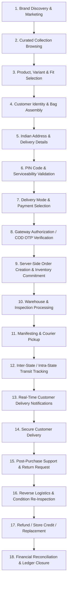
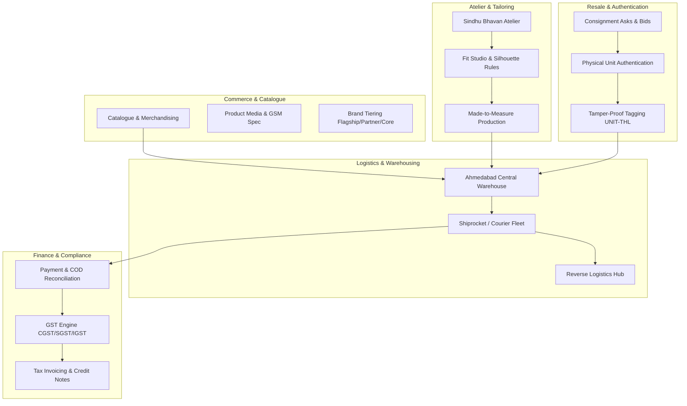

# THE HIDDEN LABEL — MASTER BUSINESS ARCHITECTURE
**Comprehensive Operating Model for Indian Luxury Fashion E-Commerce**

---

## 1. Executive Business Overview

**THE HIDDEN LABEL** (operating under Harvi Fashion / The Hidden Label Luxury Retail Pvt. Ltd.) is an omnichannel luxury fashion and streetwear platform headquartered in Ahmedabad, Gujarat (Sindhu Bhavan Road, Bodakdev). Unlike conventional mass-market fashion e-commerce, the business operates a hybrid model spanning four distinct luxury pillars:

1. **Curated Multi-Brand Boutique:** Primary retail of authenticated global luxury labels (e.g., Fear of God, Essentials, Represent, Salomon, Maison Margiela) imported or procured through authorized distribution channels.
2. **In-House Bespoke Atelier:** Bespoke tailoring, made-to-measure co-ords, luxury shirting, and suiting crafted by in-house master tailors on Sindhu Bhavan Road.
3. **Verified Resale & Consignment Marketplace:** A CultureCircle / StockX style peer-to-peer and consignment marketplace for authenticated deadstock sneakers, collectibles, and pre-owned luxury garments featuring live bids, asks, and historical price indices.
4. **Physical Inspection & Authentication Facility:** A zero-trust inspection laboratory where every consignment unit and high-value return undergoes multi-point physical verification, receiving a tamper-evident physical seal and unit-level digital certificate (`UNIT-THL-XXXXX`).

---

## 2. Complete 18-Stage End-to-End Customer & Order Lifecycle

### Stage-by-Stage Operational Specification

#### Stage 1: Brand Discovery & Marketing
- **Channels:** Social acquisition (Instagram, WhatsApp Luxury Concierge, influencer seeding), Google Search / SEO, private invitation drops.
- **Customer Mindset:** High-intent luxury buyers seeking exclusivity, authenticity guarantees, and verified fit guidance.

#### Stage 2: Curated Collection Browsing
- **Experience:** Minimalist, typography-driven luxury UI (editorial hero banners, curated brand lookbooks, season drops).
- **Taxonomy:** Clear hierarchy across Men, Women, Footwear, Bespoke Atelier, Pre-Owned / Consignment, and Featured Brands.

#### Stage 3: Product, Variant & Fit Selection
- **Product Card / PDP:** High-resolution product imagery, fabric composition, GSM specifications, wash care, country of origin, and transparent retail pricing.
- **Fit Studio Integration:** Silhouette-based size recommendation matching customer measurements (chest, waist, inseam, preferred ease) against garment block patterns.
- **Condition Disclosure:** For consignment/resale items, explicit condition grading (Brand New In Box, Excellent, Good) linked to photographic proof.

#### Stage 4: Customer Identity & Bag Assembly
- **Authentication:** Password-authenticated accounts or secure guest checkout with email and Indian mobile number binding.
- **Cart Engine:** Multi-item bag supporting line-item variant locks, instant promotion code redemption, and bag reservation timers for high-heat drops.

#### Stage 5: Indian Address & Delivery Details
- **Address Format:** Standard Indian postal specifications:
  - Recipient Full Name and 10-digit Mobile Number.
  - Flat / House Number, Apartment / Villa Complex Name.
  - Street, Road, or Sector.
  - Locality, Neighborhood, or Colony.
  - Landmark (critical for Indian last-mile couriers).
  - City / Town / Village, District, State / Union Territory.
  - 6-digit Indian Postal Index Number (PIN Code).
  - Address Classification (Home, Work, Other).

#### Stage 6: PIN Code & Serviceability Validation
- **Logistics Intelligence:** Instant verification of the 6-digit PIN code against logistics network (Shiprocket / Delhivery / Blue Dart):
  - Express vs Standard courier routing.
  - Cash-on-Delivery (COD) cash-handling serviceability.
  - Estimated delivery date (EDD) SLA calculation.
  - Remote area surcharge (RAS) identification.

#### Stage 7: Delivery Mode & Payment Selection
- **Fulfillment Choice:**
  - **Home Delivery:** Insured express courier dispatch from Ahmedabad central boutique.
  - **Store Pickup:** Complimentary white-glove collection at Sindhu Bhavan Road Flagship Atelier with private fitting suite reservation.
- **Payment Methods:**
  - **Prepaid Online:** Unified Payments Interface (UPI Intent / Dynamic QR), RuPay / Visa / Mastercard / American Express credit and debit cards, Net Banking across all scheduled Indian commercial banks, and no-cost cardless EMI.
  - **Cash on Delivery (COD):** Available for orders within regulatory and risk limits, strictly gated behind two-factor phone verification.

#### Stage 8: Gateway Authorization / COD OTP Verification
- **Prepaid:** Client redirected to Razorpay secure modal / UPI app. Gateway signs order HMAC; backend verifies payment signature prior to cart commitment.
- **Cash on Delivery:** Dynamic 6-digit numeric OTP dispatched via Indian DLT-registered SMS route (with transactional email fallback) to verify physical possession of the mobile number.

#### Stage 9: Server-Side Order Creation & Inventory Commitment
- **Medusa Workflow:** Atomic database transaction:
  - Decrements physical stock / locks consignment ask.
  - Freezes tax lines, gross value, discount deductions, and shipping fee.
  - Issues immutable order sequence identifier (`THL-XXXX`).
  - Dispatches transactional Order Confirmation to customer email and SMS.

#### Stage 10: Warehouse & Inspection Processing
- **Pick, Pack & Authenticate:**
  - Item picked from climate-controlled warehouse rack.
  - Physical inspection team scans unit serial number, verifies stitches, labels, tags, and hardware against brand reference ledger.
  - Security tag (`UNIT-THL-XXXXX`) attached with tamper-evident seal.
  - Enclosed in custom luxury packaging: magnetic debossed gift box, branded tissue, certificate card, and sealed waterproof outer polybag.

#### Stage 11: Manifesting & Courier Pickup
- **Logistics Handshake:**
  - Order synchronized with courier API (Shiprocket).
  - Air Waybill (AWB) assigned; shipping label and manifest generated.
  - Scheduled courier van arrives at Sindhu Bhavan Road facility; physical handover barcode scan marks order `pickup_scheduled` -> `picked_up`.

#### Stage 12: Inter-State / Intra-State Transit Tracking
- **Hub Movement:** Parcel moves through mother hub -> transit center -> delivery hub.
- **Status Sync:** Courier webhooks stream tracking milestones (`in_transit`, `out_for_delivery`, `rto`, `delivered`) into PostgreSQL event store.

#### Stage 13: Real-Time Customer Delivery Notifications
- **Communication:** Automated SMS / WhatsApp / Email updates dispatched at key milestones: Out for Delivery with delivery agent contact, OTP required for high-value handover, and final delivery confirmation.

#### Stage 14: Secure Customer Delivery
- **Handover:**
  - Prepaid: Signed delivery with customer identity verification.
  - COD: Cash or digital UPI collection at doorstep by courier agent before physical parcel handover.
  - Timestamped delivery scan marks shipment `delivered` in system.

#### Stage 15: Post-Purchase Support & Return Request
- **Eligibility:** 7-day return/exchange window for unworn items with intact security tag and original packaging. Bespoke tailored garments and final-sale consignment items flagged as non-returnable.
- **Self-Service Portal:** Customer submits return request with reason code, photographs of intact tag, and preferred resolution (replacement size, refund to original payment source, or store credit).

#### Stage 16: Reverse Logistics & Condition Re-Inspection
- **Reverse Pickup:** Automated reverse AWB generated; courier collects parcel from customer doorstep.
- **Receiving & Grading:** Parcel arrives back at Ahmedabad facility; authentication team verifies security tag barcode, inspects for wear, perfume scents, or damage. Return approved or rejected with documented photographic evidence.

#### Stage 17: Refund / Replacement Processing
- **Prepaid Refund:** Automated API refund initiated through Razorpay to original card / UPI VPA (processed in 3–5 banking days).
- **COD Refund:** Secure customer portal captures verified IFSC and Bank Account Number / UPI ID; payout initiated via automated NEFT / IMPS transfer.
- **Replacement:** New exchange order dispatched immediately upon return approval.

#### Stage 18: Financial Reconciliation & Ledger Closure
- **Tax Invoicing:** Statutory GST Tax Invoice generated:
  - Place of supply validated against customer delivery state.
  - Intra-state (Gujarat): CGST + SGST.
  - Inter-state: IGST.
  - HSN code attributed by product category.
- **Ledger Balancing:** Reconciliation across bank settlement files, courier remittance reports (COD remittances minus freight deductions), consignment vendor payouts, and GST filing ledgers (GSTR-1, GSTR-3B).

---

## 3. Brand Operations & Functional Domain Architecture

### 3.1. Luxury Catalogue & Merchandising
- **Tiering System:**
  - *Flagship Tier:* High-fashion luxury houses (Fear of God, In-house Atelier).
  - *Partner Tier:* Technical and specialist brands (Salomon S/LAB, Represent).
  - *Core Tier:* Accessible essentials and streetwear (Essentials).
- **Attribute Richness:** Every product specification must capture fabric weight (GSM), weave construction, lining material, silhouette category (Boxy, Oversized, Tailored, Slim), and care instructions.

### 3.2. Bespoke Atelier & Made-to-Measure (Harvi Fashion)
- **Concept:** Blending traditional Indian couture tailoring with contemporary luxury streetwear.
- **Workflow:** Customer selects fabric and silhouette -> Enters body measurements (Chest, Shoulder, Arm Length, Neck, Waist, Inseam) -> Master pattern-maker reviews measurements -> Garment hand-cut and assembled -> Basting fitting scheduled (in-boutique or remote video consultation) -> Final finishing and delivery.

### 3.3. Fit Studio (Intelligent Sizing Engine)
- **Algorithm:** Replaces generic static size charts with structured silhouette fit rules (`silhouette_fit_rule`).
- **Logic:** Compares customer profile measurements against brand-specific ease tolerances (e.g., Fear of God oversized tee requires +12cm chest ease; tailored atelier shirt requires +4cm chest ease). Outputs specific size recommendations with fit commentary ("Relaxed fit across shoulders, true to size at waist").

### 3.4. Resale & Consignment Marketplace
- **Two-Sided Market:**
  - *Sellers (Consignors):* List authentic sneakers/garments by creating an *Ask* at a specified price.
  - *Buyers:* Place a *Bid* or accept the lowest available Ask.
- **Escrow-Style Verification:** When a transaction matches, the seller ships the item to THL's facility first. Payout to the seller is only released *after* physical authentication passes.

### 3.5. Condition Inspection & Serialized Tagging
- **Hardware Integration:** Every verified unit is tagged with an indestructible, RFID/QR-coded tamper-evident seal.
- **Digital Registry:** The unique serial number (`UNIT-THL-XXXXX`) resolves to a public or customer-accessible verification page (`/inspection/[serial]`) displaying inspector ID, date of certification, high-magnification stitch/label photos, box condition, and grading score (10/10 Deadstock, 9/10 Mint, etc.).

### 3.6. Customer Support & Grievance Redressal
- **Operational Channels:**
  - WhatsApp Luxury Concierge: Direct styling advice, fitting assistance, order modifications.
  - Email Support: Formal dispute resolution, return assistance.
  - In-Store Personal Shopper: Sindhu Bhavan Road boutique appointment booking.
- **Regulatory Requirement:** Designated Grievance Officer published on the website, guaranteeing acknowledgment within 48 hours and resolution within 30 days under Indian Consumer Protection E-Commerce Rules.

### 3.7. Finance, Invoicing & GST Compliance
- **Tax Regimes:**
  - Apparel & Footwear ≤ ₹1,000: 5% GST (where applicable).
  - Apparel & Footwear > ₹1,000: 12% or 18% GST (Luxury luxury goods standard 18%).
- **State-of-Supply Engine:**
  - Origin: Gujarat (State Code 24).
  - Intra-State (Destination = Gujarat): 9% CGST + 9% SGST.
  - Inter-State (Destination ≠ Gujarat): 18% IGST.
- **Invoice Integrity:** Sequential, tamper-proof invoice numbers, business GSTIN, customer GSTIN (for B2B tax credits), category-accurate HSN codes (e.g., 6203/6204 for Suits/Ensembles, 6109 for T-shirts, 6403 for Footwear, 4202 for Handbags).

---

## 4. Administrative Role & Permission Hierarchy

| Role | Operational Scope | Access Boundary | Financial & User Permissions |
|---|---|---|---|
| **Owner** | Executive Management, Founders | Full global access across Storefront, Admin, Backend, DB | Complete authority: manage roles, staff invites, bank details, tax settings, full refund approvals. |
| **Manager** | Store Director, Head of Merchandising | Full operational access: Orders, Inventory, Products, Promotions, CMS | Can create promotions, publish products, manage inventory, view reports. Cannot modify roles or system configurations. |
| **Operations** | Warehouse Leads, Dispatchers | Order fulfillment, Shipment creation, Stock adjustments, Inbound inspection | Can mark fulfilled, generate shipments, input AWBs, log inspection reports. Cannot access financials, customer PII beyond shipping labels, or user administration. |
| **Support** | Client Services, Stylists, Concierge | Customer profiles, Order status, Return requests, Fit inquiries | Read-only access to customer orders and tracking. Can submit return requests on behalf of customers. Cannot edit products, prices, or issue unvetted refunds. |
| **Readonly** | Auditors, Investors, Trainees | Read-only analytics, catalogue browsing, audit logs | Strictly read-only on non-PII and non-financial data. Zero mutation capability. |

---

## 5. Architectural Maturity & Target State Summary

| Domain | Ideal Luxury Target State | Current System Reality | Gap Severity |
|---|---|---|---|
| **Core Commerce** | Atomic cart-to-order transition with automated stock locks | Fully operational on Medusa 2.22.7 core with PostgreSQL | Low / Operational |
| **Payment Gateway** | Live multi-rail Indian checkout (Razorpay UPI, RuPay, Cards, EMI) | Unconfigured; only Cash on Delivery selectable; no frontend Razorpay SDK | **CRITICAL** |
| **Logistics** | Automated Shiprocket dispatch, live AWB, real courier rates, NDR | Unconfigured credentials; falls back to manual shipment entries; hardcoded package dimensions | **HIGH** |
| **Tax & Invoicing** | Dynamic CGST/SGST/IGST calculation, seeded tax slabs, dynamic HSN | Zero tax configuration in DB; dummy GSTIN; hardcoded CGST/SGST nationwide; hardcoded HSN 6403 | **CRITICAL** |
| **SMS & Phone OTP** | DLT-registered Indian SMS gateway for phone verification and COD | Zero SMS provider code implemented; only simulated console echo; vulnerable to cart metadata forgery | **CRITICAL** |
| **Transactional Email**| Automated lifecycle emails across all 18 order stages via Resend | Resend unconfigured; only 3 email calls exist; zero order/shipment/delivery confirmation emails | **HIGH** |
| **Customer Support** | Omni-channel ticketing, WhatsApp concierge, statutory Grievance Officer | Static FAQ CMS page; no contact form; no ticketing system; no Grievance Officer | **HIGH** |
| **Resale & Inspection**| Live peer-to-peer bidding engine, tamper-proof tag scanner | Data models and basic API routes exist; UI behind feature flags; inspection certs operational | **MEDIUM** |
