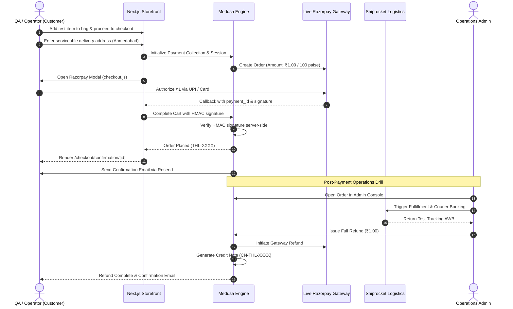

# THE HIDDEN LABEL — PRODUCTION SMOKE TEST PROTOCOL

**Execution Window:** Staging Rehearsal & Post-Cutover Live Go-Live Verification  
**Scope:** Controlled Validation of Complete Customer & Operational Workflows  
**Author:** QA Lead & Senior Integration Engineer  

---

## 1. Test Tier Classification

To maintain complete financial and operational safety, smoke tests are strictly divided into two authorization tiers:

- **Tier 1 (Non-Destructive / Zero-Cost):** Can be executed immediately on staging or production without special financial authorization. Tests browsing, session auth, validation, cart state, and read-only admin dashboards.
- **Tier 2 (Authorized Live Financial Drill):** Executed only during the scheduled go-live cutover window with explicit business owner authorization. Involves a single ₹1 real UPI/Card payment, real email receipt, live Shiprocket AWB simulation, and immediate refund.

---

## 2. Tier 1: Non-Destructive Smoke Tests

| Test ID | Area | Action / Procedure | Expected Result | Pass Criteria |
|---|---|---|---|---|
| **ST-01** | **Health Probes** | `curl -I https://thehiddenlabel.com/api/health` `curl -I https://admin.thehiddenlabel.com/api/health` `curl -I https://api.thehiddenlabel.com/healthz` | All return HTTP 200 OK | Database and Redis respond within `< 100ms`. |
| **ST-02** | **Catalog Navigation** | Open `/collections/all` in browser | Catalog displays paginated pieces (`PAGE_SIZE = 24`, Page X of Y) | Products render with INR prices, variant selectors, and images. |
| **ST-03** | **Legal Metrology** | Open any luxury product PDP (e.g. `/products/saint-laurent-bomber`) | Country of Origin displayed prominently | Origin is stated truthfully; never masked with fabricated defaults. |
| **ST-04** | **Customer Auth** | Register a new vault account at `/register` | Account created; redirected to verification prompt | Stored customer record contains DPDP consent timestamp. |
| **ST-05** | **Cart Operations** | Add item to bag; navigate to `/cart` | Item appears in bag with subtotal and live tax calculations | Cart persists across browser navigation. |
| **ST-06** | **PIN Serviceability**| At checkout step 1, enter unserviceable PIN `999999` | System halts checkout with warning: *"We don't deliver to this pincode yet."* | Prevents taking payment for undeliverable parcels. |
| **ST-07** | **Admin RBAC** | Attempt admin login with account having no role | Screen renders: *"Access denied — No staff role assigned"* | Fail-closed security verified (`SEC-01`). |
| **ST-08** | **Purchasing & PO** | Draft a PO for 5 units in admin console | PO display ID generated (`PO-THL-XXXX`) | Sequence numbers allocate non-colliding IDs. |

---

## 3. Tier 2: Authorized Live Production Smoke Drill (Real Gateway Smoke)

*Requirement:* Authorized business owner approval and an active payment instrument with ₹1 limit.

### Step-by-Step Drill Execution:

1. **Step 1: Test Item Setup**
   - In Admin console, create a temporary hidden test product: *"Go-Live Verification Token"*, price: `₹1.00`.
   - Ensure stock level is set to `10`.

2. **Step 2: Customer Checkout**
   - Log into storefront using an authorized test customer account.
   - Add the ₹1 token to cart and proceed to Checkout.
   - Enter a valid delivery address with an Ahmedabad PIN (e.g., `380054`).

3. **Step 3: Live Payment Authorization**
   - Select UPI or Card on the payment step.
   - Razorpay modal opens displaying live merchant branding: *THE HIDDEN LABEL*.
   - Complete the ₹1 transaction.

4. **Step 4: Webhook & Order Creation Verification**
   - Verify immediate redirection to `/checkout/confirmation/[id]`.
   - Verify the display ID appears formatted as `THL-XXXX`.
   - Inspect backend logs to confirm receipt of webhook `payment.captured` with HTTP 200 acknowledgment.
   - Inspect customer inbox to confirm receipt of transactional order confirmation email via Resend.

5. **Step 5: Admin Order Processing Drill**
   - Log into `https://admin.thehiddenlabel.com`.
   - Verify the new order appears in the Orders list with status `pending`.
   - Open order detail view; confirm payment status is `captured`.

6. **Step 6: Logistics AWB Booking Drill**
   - In order actions, click **Fulfill Order**.
   - Verify courier pickup resolution selects the primary warehouse location.
   - Confirm Shiprocket returns a tracking AWB number.

7. **Step 7: Immediate Refund & Credit Note Generation**
   - In the admin order detail view, click **Issue Refund**.
   - Enter amount `1.00`, reason: *"Post-cutover verification test drill"*.
   - Submit refund.
   - Verify Razorpay dashboard reflects the ₹1 refund immediately.
   - Verify database allocates a sequential GST credit note number (`CN-THL-XXXX`).
   - Confirm available inventory is restored atomically.

8. **Step 8: Cleanup**
   - Archive or delete the temporary ₹1 test token product.
   - Record smoke test completion in the deployment sign-off log.
