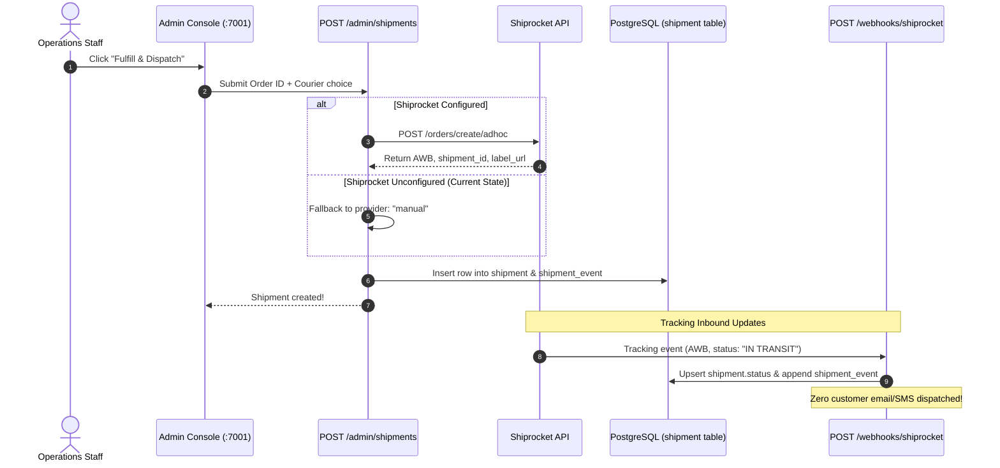

# THE HIDDEN LABEL — SHIPPING, COURIER & LOGISTICS AUDIT
**Investigation of Shiprocket Integration, Fulfillment Workflows, Real-Time Webhooks, and Reverse Logistics**

---

## 1. Executive Summary & Operational Verdict

### **VERDICT: ⚠️ SCAFFOLD ONLY — UNCONFIGURED & FALLS BACK TO MANUAL DISPATCH**

> [!IMPORTANT]
> The logistics architecture contains a well-structured HTTP client for Shiprocket's REST API and an idempotent webhook receiver. However:
> 1. **Credentials Missing:** `SHIPROCKET_EMAIL` and `SHIPROCKET_PASSWORD` are unset; `isConfigured()` returns `false`, causing all dispatches to fall back to manual offline tracking entries (`provider: "manual"`).
> 2. **Hardcoded Dispatch Payload:** When Shiprocket is called, package dimensions (30×20×12 cm, 0.6 kg) and `paymentMethod: "COD"` are **hardcoded**, even for prepaid parcels or heavy luxury overcoats/boots.
> 3. **Zero Reverse Logistics Integration:** Customer returns do not generate automated reverse AWBs or pickup requests with Shiprocket.
> 4. **No Customer Notifications:** Inbound carrier webhooks record milestone events in the database but **do not dispatch SMS, WhatsApp, or email notifications** to the customer.

---

## 2. Courier Provider Architecture & Shiprocket Client

### 2.1. Client Engineering
- **File:** `apps/backend/src/lib/shiprocket.ts`
- **Base Endpoint:** `https://apiv2.shiprocket.in/v1/external`
- **Authentication Lifecycle:**
  - Token acquired via `POST /auth/login` using `SHIPROCKET_EMAIL` and `SHIPROCKET_PASSWORD`.
  - In-memory token caching with a 9-day TTL:
    ```typescript
    cachedToken = { token: body.token, expiresAt: Date.now() + 9 * 24 * 60 * 60 * 1000 };
    ```
- **Order Dispatch Endpoint:** `POST /orders/create/adhoc`
- **Payload Inspection (`shiprocket.ts` lines 107–134):**
  - Sends: `order_id`, `order_date`, `pickup_location`, customer address, items array, subtotal.
  - **Defect 1 (Hardcoded Payment Method):** In `apps/backend/src/api/admin/shipments/route.ts#L132`, `paymentMethod: "COD"` is hardcoded for all Shiprocket dispatches. If an order was paid online, Shiprocket couriers will mistakenly attempt to collect cash at the customer's doorstep!
  - **Defect 2 (Static Box Dimensions):** Dimensions are hardcoded to `length: 30`, `breadth: 20`, `height: 12`, `weight: 0.6 kg`. Heavy luxury garments (e.g., tailored wool coats, leather boots) will trigger massive volumetric weight discrepancies and courier penalties.

---

## 3. Forward Logistics Lifecycle & Operational Triggers



### 3.1. Fulfillment & Shipment Creation
- **Trigger:** Admin clicks "Fulfill" on `/admin/orders/:id`, followed by shipment generation on `/admin/shipments`.
- **Backend Handler:** `apps/backend/src/api/admin/shipments/route.ts`.
- **Database Mutated:** Inserts row into `shipment` (`id: "shp_..."`) and initial event into `shipment_event` (`id: "shpe_..."`).

### 3.2. Webhook Synchronization & Idempotency
- **Endpoint:** `POST /webhooks/shiprocket`
- **Security:** Requires `SHIPROCKET_WEBHOOK_TOKEN` header or query param.
- **Idempotency:** Generates unique composite key `${status}-${scan_date}`; applies PostgreSQL `ON CONFLICT (shipment_id, event_key) DO NOTHING`. Replayed webhooks are discarded without duplicate state transitions.
- **Status Mapping (`src/lib/shipment-status.ts`):**

| Shiprocket Raw Status | Mapped System Status | Storefront Customer Label | Order Status Impact | Customer Alert |
|---|---|---|---|---|
| `NEW` / `PICKUP SCHEDULED` | `pickup_scheduled` | "Preparing for pickup" | None | None |
| `PICKED UP` | `picked_up` | "Picked up" | None | None |
| `IN TRANSIT` | `in_transit` | "In transit" | None | None |
| `OUT FOR DELIVERY` | `out_for_delivery` | "Out for delivery" | None | None |
| `DELIVERED` | `delivered` | "Delivered" | **None** (Order remains `pending`) | **None** |
| `RTO INITIATED` / `RTO` | `rto` | "Returning to origin" | None | None |
| `CANCELLED` | `cancelled` | "Shipment cancelled" | None | None |

### 3.3. Disconnection from Medusa Core Order State
When the carrier webhook reports `DELIVERED`:
- `shipment.status` is updated to `delivered`.
- `shipment.delivered_at` is populated.
- **Medusa `order.status` is NOT updated!**
- **Medusa `order.fulfillment_status` is NOT updated!**
- The order remains indefinitely in its initial status in Medusa core.

---

## 4. Reverse Logistics & RMA Coordination

| Reverse Logistics Requirement | Implementation Status | Functional Audit Findings |
|---|---|---|
| **Customer RMA Submission** | ✅ Implemented | Customer selects items and reason at `/account/orders/:id/return`. Row created in `return_request`. |
| **Admin RMA Review** | ✅ Implemented | Staff reviews and approves return at `/admin/returns/:id`. |
| **Automated Reverse AWB** | ❌ **NOT IMPLEMENTED** | No call to Shiprocket reverse pickup API (`/orders/create/return`). |
| **Reverse Courier Tracking** | ❌ **NOT IMPLEMENTED** | Customer and admin have zero visibility into return transit. |
| **Warehouse Re-Inspection** | ⚠️ Manual | Staff manually marks return approved/rejected; no link to `condition_inspection`. |
| **Automated Refund Trigger** | ❌ **NOT IMPLEMENTED** | Approving return does not initiate Razorpay refund or capture bank details for COD. |

---

## 5. Required Remediation for Logistics Production Readiness

1. **Configure Shiprocket Production Secrets:**
   - Add `SHIPROCKET_EMAIL`, `SHIPROCKET_PASSWORD`, `SHIPROCKET_PICKUP_LOCATION`, and `SHIPROCKET_WEBHOOK_TOKEN` to environment.
2. **Fix Dynamic Payment Method & Dimensions:**
   - In `src/api/admin/shipments/route.ts`, determine `paymentMethod` from `order.payment_collections` (send "COD" only for COD orders; "Prepaid" for online payments).
   - Calculate box dimensions dynamically from product category (e.g. Footwear box: 35×25×15 cm, 1.2 kg; Shirt: 30×20×5 cm, 0.4 kg).
3. **Synchronize Medusa Order & Fulfillment States:**
   - When carrier webhook reports `delivered`, update Medusa core `order.fulfillment_status = 'delivered'` and `order.status = 'completed'`.
4. **Trigger Customer Notifications on Milestone Events:**
   - Dispatch SMS/WhatsApp on `picked_up`, `out_for_delivery`, and `delivered`.
5. **Implement Shiprocket Reverse Logistics:**
   - When an RMA is approved by admin, call Shiprocket reverse pickup API and return the customer's reverse shipping label.
