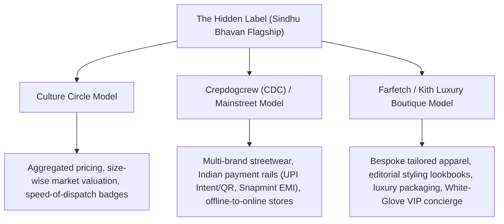
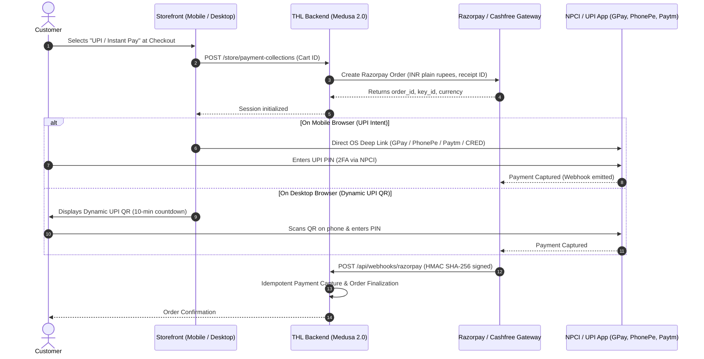

# The Hidden Label — Omnichannel Digital Master Blueprint
## Transitioning the Sindhu Bhavan Road Flagship Boutique to a 24/7 National Digital Platform

---

## 1. Executive Summary & Business Reality

* **Physical Identity**: **The Hidden Label** (by Harvi Fashion) is an established physical luxury fashion house located at **Steller, 205, 2nd Floor, Sindhu Bhawan Road, Bodakdev, Ahmedabad, Gujarat 380059**.
* **Instagram**: [@thehiddenlabel.official](https://www.instagram.com/thehiddenlabel.official)
* **Core Product Portfolio**:
  1. **Custom Bespoke Apparel (Men & Women)**: Custom tailored shirts, trousers, suits, blazers, luxury co-ords, ethnic fusion, and made-to-measure streetwear.
  2. **Curated Multi-Brand Luxury Streetwear**: Imported premium brands (Fear of God, Represent, Essentials, Palm Angels, Off-White, Balenciaga), designer labels, and in-house Harvi Fashion creations.
  3. **Curated Limited-Edition Footwear & Sneakers**: High-demand Jordan, Nike, Yeezy, and New Balance pairs.
  4. **Luxury Accessories**: Designer eyewear, fragrances, jewelry, and bags.
* **The Strategic Objective**: Enable customers anywhere in India (and in-store clients visiting the Sindhu Bhavan boutique) to browse the complete curated collection, configure custom measurements, check out 24/7 via seamless Indian payment rails (UPI, Cards, Netbanking, COD), track custom tailoring orders, and choose between home delivery or in-store pickup.

---

## 2. Competitive Reverse Engineering: The Best Indian & Global Benchmarks

We reverse-engineered three leading reference models in India and globally:



| Dimension | Culture Circle | Crepdogcrew (CDC) / Mainstreet | Farfetch / Kith | The Hidden Label (Target State) |
| :--- | :--- | :--- | :--- | :--- |
| **Primary Category** | Secondary sneakers & streetwear marketplace | Multi-brand curated streetwear + footwear + retail stores | Multi-brand designer apparel + private label | **Custom bespoke apparel + Multi-brand designer + Curated footwear** |
| **Custom Tailoring / Sizing**| Standard fixed sizes only | Standard ready-to-wear sizing (XS–XXL) | Custom measurement guides | **Full Made-to-Measure Studio (Chest, Waist, Length, Fabric, Inseam)** |
| **Payment Rails** | UPI, Cards, Snapmint EMI | UPI (Intent/QR via Razorpay/Cashfree), Cards, Netbanking, Partial COD | Global cards, Apple Pay, Klarna | **Seamless Indian Stack: UPI (Intent/QR), RuPay/Visa/Mastercard, 0% Cardless EMI, COD with OTP** |
| **Storefront Architecture** | Next.js App Router (RSC), Tailwind CSS, Framer Motion | Shopify Plus with custom Liquid/Edge theme, Cloudflare CDN | Next.js / React micro-frontends | **Next.js App Router (RSC) + Tailwind v4 + Medusa 2.0 Headless Engine** |
| **Inventory Model** | Multi-vendor consignment | Dual: Warehouse + Flagship Stores (Delhi/Mumbai) | Global boutique network | **Unified Omnichannel (Sindhu Bhavan Boutique + Online Fulfillment)** |
| **Logistics** | Shiprocket courier dispatch | Shiprocket, Bluedart, In-Store Pickup | DHL Express global white glove | **Shiprocket express courier + In-Store Pickup (Bodakdev, Ahmedabad)** |

---

## 3. Indian Payment Stack: Deep Technical Architecture

In India, **75%+ of digital e-commerce transactions occur over UPI**. A platform offering only basic card fields will suffer an immediate 60%+ cart abandonment rate.



### Supported Payment Modes:
1. **UPI Intent (Mobile Native)**:
   * Triggers native intent directly into Google Pay, PhonePe, Paytm, or CRED without redirecting to a clunky intermediate screen.
2. **Dynamic UPI QR (Desktop)**:
   * Generates a dynamic transaction QR on screen with exact order total in INR. Customer scans with phone and checkout auto-refreshes on payment success.
3. **Credit & Debit Cards**:
   * RuPay (now supporting UPI credit lines), Visa, Mastercard, and American Express with 3D Secure 2.0 OTP authentication.
4. **Cardless 0% EMI (BNPL)**:
   * Integrated via Snapmint / Simpl / ZestMoney / Razorpay Affordability. Essential for luxury purchases ranging from ₹15,000 to ₹1,50,000.
5. **Cash on Delivery (COD) with Safety Mechanisms**:
   * *The Problem*: High-value fashion and footwear suffer a 30–45% Return-to-Origin (RTO) rate on raw COD.
   * *The Solution*:
     * **Phone OTP Pre-Verification**: We enforce mobile OTP verification before COD order placement (already built in our backend!).
     * **Partial Advance Token**: Optional ₹500–₹1,000 online UPI deposit, with remaining balance paid on delivery.

---

## 4. Dual-Sided Data & Storage Architecture

```mermaid
flowchart LR
    subgraph StorefrontLayer["Storefront (Client Facing)"]
        S1["Product Catalog & Filter Drawer"]
        S2["Custom Bespoke Measurement Studio"]
        S3["Cart, Stock Reservation & Checkout"]
        S4["Order Tracking & WhatsApp Bot Link"]
    end

    subgraph BackendCore["THL Medusa 2.0 Backend Core"]
        B1["Product & Multi-Brand Module"]
        B2["Custom Apparel Measurement Engine"]
        B3["Omnichannel Inventory Sync (Store + Web)"]
        B4["Order State Machine (RTW vs Custom)"]
        B5["Webhooks (Razorpay & Shiprocket)"]
    end

    subgraph StorageLayer["Data & Cloud Storage Layer"]
        D1[("PostgreSQL Database: Orders, Customers, Inventory, Bids")]
        D2[("Cloud Object Storage (S3 / GCS / Cloudinary): HD Media")]
        D3[("Append-Only Audit Stream: Financial & Stock Mutations")]
    end

    subgraph AdminLayer["Admin / Merchant (Shop Owner Facing)"]
        A1["Product Catalog & Fabric Uploader"]
        A2["Bespoke Tailoring Pipeline (Cutting -> Stitching -> QC)"]
        A3["Omnichannel POS Sync (Sindhu Bhavan Store)"]
        A4["Shipping Labels (Shiprocket) / In-Store Pickup"]
    end

    StorefrontLayer <--> BackendCore
    BackendCore <--> StorageLayer
    BackendCore <--> AdminLayer
```



### A. Storefront Data Management
* **Catalog Querying**: Cached via Next.js React Server Components (RSC) and tagged cache revalidation.
* **Custom Measurement Persistence**:
  When a customer orders a custom bespoke outfit, their measurements (Chest, Waist, Shoulders, Inseam, Hip, Length, Preferred Fit, and Special Instructions) are serialized into the line-item metadata:
  ```json
  {
    "is_custom": true,
    "garment_type": "bespoke_shirt_trousers_set",
    "measurements": {
      "chest_inches": 42.5,
      "waist_inches": 36.0,
      "shoulder_inches": 18.5,
      "trouser_length_inches": 40.0,
      "fit_preference": "slim_tailored",
      "monogram_text": "MD"
    }
  }
  ```
* **Media Loading**: High-resolution fabric lookbooks and video reels stored in cloud object storage, transformed on the fly (AVIF/WebP) with responsive breakpoints.

### B. Admin & Merchant Data Management
* **Multi-Brand & Multi-Category Management**:
  * Admin can create and manage arbitrary brands: In-House Bespoke (The Hidden Label / Harvi), Represent, Fear of God, Balenciaga, Off-White, Nike, Jordan.
  * Define category trees: Menswear, Womenswear, Footwear, Bespoke Custom, Accessories.
* **Bespoke Order Processing Workflow**:
  Standard e-commerce only has `pending -> fulfilled -> shipped`. Luxury custom tailoring requires a dedicated staging workflow:
  1. `Order Placed (Measurements Received)`
  2. `Measurements Reviewed by Master Tailor`
  3. `Fabric Sourcing & Cutting`
  4. `In Stitching & Embroidery`
  5. `Quality Check & Ironing`
  6. `Ready for Dispatch / In-Store Pickup`
  7. `Delivered & Client Feedback`
* **Unified Omnichannel Inventory Synchronization**:
  * The physical boutique on Sindhu Bhavan Road and the digital storefront share a single real-time inventory ledger.
  * When a garment or sneaker sells to a walk-in customer at the store, the admin marks it sold, and online stock decrements instantly, preventing overselling.

---

## 5. End-to-End Gap Analysis & Implementation Roadmap

### Phase 1: Product Model Pivot & Custom Measurement Studio
* **Objective**: Transform THL from a pure footwear-focused schema to a luxury multi-brand apparel & bespoke platform.
* **Deliverables**:
  1. Update `StoreProduct` to support `category_type`: `"ready_to_wear"`, `"bespoke_custom"`, `"footwear"`, `"accessory"`.
  2. Build the **Bespoke Sizing & Customization Drawer** on the PDP for custom apparel (men & women).
  3. Enable multi-brand showcase pages (`/brands/[handle]`) for boutique labels.

### Phase 2: Production Indian Payment Rails (Razorpay & Cashfree)
* **Objective**: Enable seamless, high-converting checkout across India.
* **Deliverables**:
  1. Razorpay Payment Provider integration with active UPI Intent (GPay, PhonePe, Paytm, CRED).
  2. Dynamic UPI QR code modal for desktop checkouts.
  3. Partial COD option with OTP verification.
  4. Cardless EMI breakdown widget on PDP (e.g. *"or ₹X/mo with Snapmint / Cards"*).

### Phase 3: Omnichannel Store Integration (Sindhu Bhavan Road)
* **Objective**: Connect the physical store experience to the digital platform.
* **Deliverables**:
  1. **"Pick Up at Store"** option at checkout (Bodakdev, Sindhu Bhavan Road, Ahmedabad).
  2. Custom tailoring order status tracker for clients.
  3. WhatsApp order notification & concierge dispatch integration.
